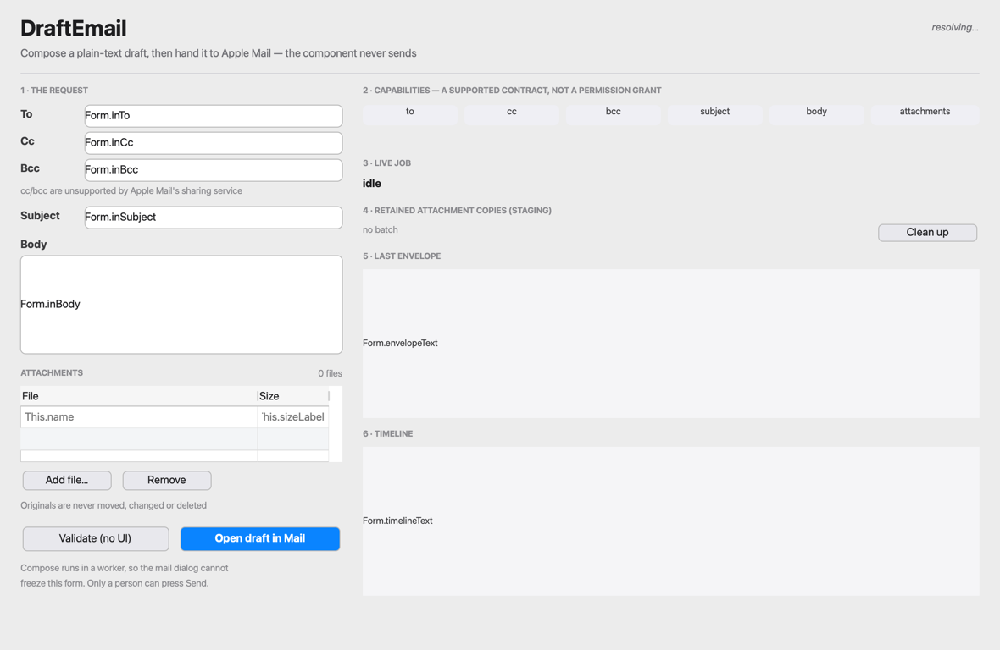
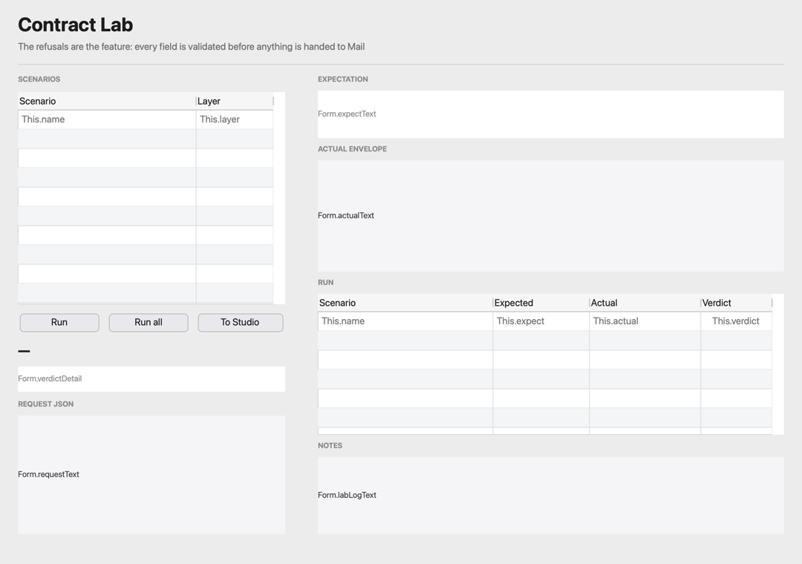

# DraftEmail-demo

An interactive 4D demo of [miyako/DraftEmail](https://github.com/miyako/DraftEmail) `0.1.4`
— a component that hands a draft message to the user's own mail client and never sends it.

The demo has two windows:

* **Draft Studio** — fill in a mail, read the request snapshot the component will see, and
  watch `validate` answer before anything is composed. `Compose` is available but deliberately
  behind a button, because it opens Apple Mail.
* **Contract Lab** — thirteen scenarios that each provoke one specific refusal, run against the
  real component and compared with the outcome declared in the catalogue.





Those images are static renders of the two forms (`tools/4dform/fourdform`), not runtime
captures; see [docs/FINDINGS.md](docs/FINDINGS.md#7-no-runtime-screenshots-from-tool4d) for why.

## What it demonstrates

| Point | Where to look |
| --- | --- |
| `capabilities` is a support contract, not a permission grant | The six chips under the badge are painted from the live `capabilities` reply, so `cc` and `bcc` read `✗` on macOS and would read `✓` on Windows with no platform branch in the UI. |
| A refusal has a layer | Every Lab row names its layer: `component` (pre-check, no process starts), `native` (the CLI answered with a JSON error and a non-zero exit code), `prelaunch` (`unsupported_architecture`, nothing was launched). |
| Handoff is not delivery | `deliveryConfirmed` is `false` in the capability object, and the form says so instead of showing a fake "sent" state. |
| Limits are byte limits | `multibyte-subject` sends 400 characters — under the character count a person would guess — and the CLI still refuses because 400 `あ` is 1200 UTF-8 bytes against a 998-byte budget. |
| The protocol is closed | An unknown field is refused, and the form shows which extra key it sent. |
| Composing is asynchronous | `compose` returns a job handle; the form polls it in `On Timer` and shows the polling count, so the window keeps painting while the mail dialog is open. |
| Staging is explicit | A compose with attachments returns a 32-hex token; `Cleanup` is what deletes the helper-owned copies, and a stale token is refused rather than ignored. |

## Requirements

* 4D 21.2 LTS (the project is `compatibilityVersion: 2102`).
* The `DraftEmail` component is declared in
  [`Project/Sources/dependencies.json`](Project/Sources/dependencies.json) as
  `{"github":"miyako/DraftEmail","tag":"0.1.4"}`. 4D resolves it from the Dependency manager on
  first open.

`tool4d` can run the code but cannot download that dependency; prime its cache first if you want
headless runs — see [docs/FINDINGS.md](docs/FINDINGS.md#1-tool4d-cannot-resolve-a-dependency-manager-dependency).

## Run

```sh
open -a "4D 21.2 LTS" Project/DraftEmail-demo.4DProject
```

`On Startup` opens Draft Studio. The `Demo` menu opens the Contract Lab and returns to the studio.
`Contract Lab ▸ To Studio` seeds the studio with whatever request the selected scenario used, so you
can see how the refusal was produced.

## Headless acceptance

The demo can prove itself without a window or a mail client. `Demo_HeadlessSmoke` binds
`DraftScene` to a plain object instead of a form, runs one `validate`, then runs all thirteen Lab
scenarios and writes a JSON report:

```sh
tool4d --project Project/DraftEmail-demo.4DProject --dataless --skip-onstartup \
  --startup-method Demo_HeadlessSmoke --user-param '{"out":"/tmp/DraftEmail-demo-smoke.json"}'
```

```json
{
  "passed": true,
  "summary": "13 of 13 expectations matched",
  "studio": {
    "validate": {"ok": true, "value": {"protocol": 1, "status": "validated"}},
    "badge": "ns-sharing-service · cli 0.1.4 · macOS-universal"
  }
}
```

It never calls `compose`, so no mail client opens and no draft is created.

## The thirteen scenarios

| id | request | layer | expectation |
| --- | --- | --- | --- |
| `minimal` | one recipient, subject, body | `native` | `validated` |
| `cc-on-macos` | non-empty `cc` | `native` | `unsupported_field` |
| `display-name` | `Dana Reed <dana@example.com>` | `native` | `invalid_request` |
| `missing-attachment` | absolute path, no file | `native` | `invalid_attachment` |
| `relative-attachment` | `invoices/…pdf` | `component` | `invalid_argument` |
| `too-many-recipients` | 101 addresses | `component` | `invalid_argument` |
| `nul-in-subject` | embedded NUL | `component` | `invalid_argument` |
| `multibyte-subject` | 400 × `あ` = 1200 bytes | `native` | `limit_exceeded` |
| `unknown-field` | extra `attachmentsDir` | `component` | `invalid_argument` |
| `protocol-2` | `"protocol": 2` | `component` | `invalid_argument` |
| `windows-target` | `"Windows-x64"` on macOS | `prelaunch` | `unsupported_architecture` |
| `stale-token` | well-formed but unissued token | `native` | `invalid_staging` |
| `capabilities` | — | `native` | `ok` |

## Layout

```
Project/Sources/
  Classes/DraftScene.4dm     studio state, component calls, form presentation
  Classes/DraftLab.4dm       scenario catalogue and the run loop
  Forms/DraftStudio/         form.4DForm + method.4dm
  Forms/ContractLab/         form.4DForm + method.4dm
  Methods/                   Demo_OpenStudio, Demo_OpenLab, On Startup, Demo_HeadlessSmoke
  styleSheets.css            light and dark rules shared by both forms
scripts/make_forms.py        regenerates both .4DForm files from data
tools/                       4dform, 4dlsp and 4dlanguage binaries from the miyako/skills `4dtools`
                             skill; provisioned locally and not committed
.agents/                     miyako/skills, as a submodule
```

Forms are generated data, not hand-edited XML: `python3 scripts/make_forms.py` rewrites both
`form.4DForm` files and reports overlapping objects. Behaviour lives in the `*Scene`/`*Lab`
classes and in each form method, which dispatches on `FORM Event.objectName` and reads its data from
`Form` (a form method takes no parameters).

## Documentation

* [docs/FINDINGS.md](docs/FINDINGS.md) — chokepoints, failures and findings from building this,
  including the tool4d dependency-cache workaround.
* [Documentation/Classes/DraftScene.md](Documentation/Classes/DraftScene.md)
* [Documentation/Classes/DraftLab.md](Documentation/Classes/DraftLab.md)

## Not verified here

`compose` was never run in this repository: it opens Apple Mail on a real desktop and cannot be
asserted in a headless run. The Windows target, `simple-mapi` client and the 540-second compose
deadline are described from the component's protocol documentation, not exercised.
